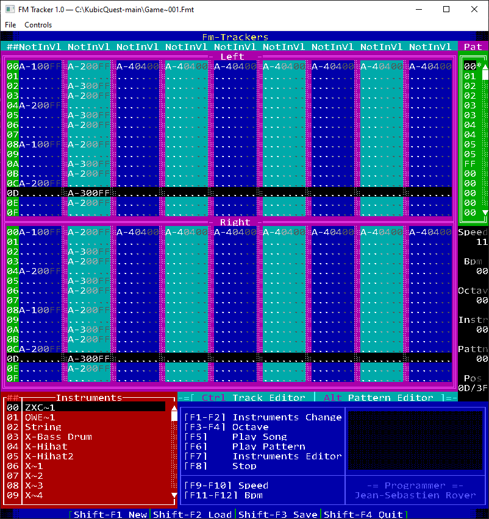

# FM Tracker - Win32 C++ port

**[Note]** I asked AI to port my computer science school project of 2000 from 100% assembly code for DOS into Win32 C/C++ code. 
It took ~12 minutes and 2 iterations. I added a screenshot, a tiny clean-up (e.g .gitignore) and applied clang-format.



Original Repository: https://github.com/XorJS/FM-Tracker
More info here: https://www.jsr-productions.com/blogpost3319ddc.html

...

Port of the supplied `FM.ASM` by Jean-Sebastien Royer. Native C++17, Win32 GDI text rendering, Windows keyboard events, and 48 kHz stereo waveOut audio using the bundled Nuked OPL3 emulator. No DOSBox, assembler, privileged I/O driver, SDL, or internet connection is required to build or run it.

## Audio correction

The first port refilled waveOut buffers through the window message loop. Expensive GDI paints or a blocked UI could starve the audio queue, causing gaps and slower wall-clock playback. Version 1.0 uses a dedicated CRT worker thread, a waveOut completion event, MMCSS audio scheduling (with an above-normal thread-priority fallback), and six 10 ms buffers. It primes the paused device before starting playback. The title bar identifies this build as **FM Tracker**.

Tracker access is synchronized; GDI calls, modal dialogs and disk I/O occur outside the audio lock. File loading stages data before committing it. Shutdown joins the worker before resetting the device or freeing buffers. There is no change to the OPL register sequences or PIT-derived tempo.

Recompiled the Windows binary and passed the core sanitizer tests, including sample-for-sample and row-count equivalence between continuous rendering and 10 ms blocks under an 18-channel workload. The event-driven Windows device path has been compiled and reviewed, but has not been runtime-tested here. Acceptance: play the same FMT while resizing/moving the window and opening the Controls dialog; audio should remain continuous and tempo should remain stable.

## Run / build

`FM_Tracker.exe` is the cross-compiled **32-bit Windows** build. Target Windows 10/11 (or Windows with the Universal CRT installed). C++ runtime is linked statically. An optional command-line argument opens an existing FMT file:

```
FM_Tracker.exe song.fmt
```

To rebuild, run `build.bat` from an **x86 Native Tools Command Prompt for Visual Studio** with the C++ desktop workload installed. An x64 prompt produces an x64 executable instead. Or use CMake:

```
cmake -S . -B build -A Win32
cmake --build build --config Release
ctest --test-dir build -C Release --output-on-failure
```

`FM_Win32.cpp` contains the tracker, playback, editing, file format and Win32 backend. `FM_Data.h` contains the exact extracted screen/instrument/key/frequency bytes. `vendor/opl3.c` and `opl3.h` implement the OPL3 chip. `tests.cpp` tests the platform-independent tracker code by including it with `FM_TEST` defined. The source is also included as `original/FM.ASM` for comparison.

## Controls

The window's **Controls** menu provides a reference.

| Key | Tracker action |
|---|---|
| F1 / F2 | Previous / next instrument |
| F3 / F4 | Previous / next octave |
| F5 / F6 / F8 | Play song / play pattern / stop |
| F7 | Instrument editor |
| F9 / F10 | Decrement / increment Speed byte |
| F11 / F12 | Decrement / increment BPM byte |
| Ctrl / Alt | Select track / order-list editor |
| Arrows / Tab | Move through rows and channels |
| Home / End / Page Up / Page Down | Row navigation |
| Z-row / Q-row | Enter notes using the original physical scan-code map |
| 0–9, A–F | Enter volume or order numbers in hexadecimal |
| Insert / Delete / Backspace | Insert / clear / remove a cell in the selected channel |
| Shift+F1 / Shift+F2 / Shift+F3 / Shift+F4 | New / open / save / exit |
| Escape | Exit, return from instrument editor, or cancel name editing |

The instrument column is read-only, as in the original. Note entry stores the selected instrument and leaves volume unchanged. The original blank volume FF becomes register value 00 (full volume) during playback.

In the instrument editor, F1/F2 select an instrument, F3 edits its name, and F4 returns. Hold **Alt for modulator** or **Ctrl for carrier**, then use F1 attack, F2 decay, F3 sustain, F4 release, F5 waveform, F6 attenuation, F7 key-scale level, F8 feedback, F9 additive connection, F10 multiplier. With Shift held, F1–F4 toggle KSR, sustained envelope, vibrato and tremolo. Names use the original uppercase scan-code character map; Enter commits and Escape cancels.

## Preserved behavior

- 18 channels, 64 rows, three bytes per cell; 256 order entries and 256 pattern slots. FF terminates the song order list; serializable patterns are 00–FE.
- Both original 8000-byte screen templates, CP437 character mapping and 16 VGA attribute colors. Windows font glyphs replace the VGA bitmap font, so this is not pixel-identical rendering.
- The initial instrument bytes, note-frequency words, octave packing and physical keyboard map.
- OPL register addressing, left/right routing, key-off/retrigger order, waveform, envelope and connection writes. Both operator volume registers receive `cellVolume ^ 0xFF`, deliberately ignoring the instrument attenuation byte, exactly as the source playback does. The right-bank duplicate B0 write in pattern playback is retained.
- Timing uses **1193182 / 7786 ≈ 153.25 PIT ticks per second**, not the source comment's 256. `Speed | (BPM << 8)` is the row interval because the assembly reads a word at Speed. BPM is not a conventional beats-per-minute control. Set **Speed=06, BPM=00** as a useful starting tempo. Both bytes initially remain zero, as in the source, and zero prevents playback from starting.
- Empty cells leave already playing notes active.
- The file signature and binary format remain `JSR_FMT~`, speed byte, BPM byte, 9216 instrument bytes, 256 order bytes, one count byte, then count records of one pattern number + 3456 data bytes. The actual header is **9483 bytes**, despite the source's 9683 comment.

## Deliberate corrections / platform changes

This is a behavioral C++ port, not a line-by-line register emulator. DOS flat-mode/XMS setup, interrupt installation, PIC/PIT port operations, VGA memory access and self-modifying return instructions are replaced by ordinary memory, events and methods.

- Save now includes FE: the original loop iterates 00–FD despite counting 00–FE. Already damaged legacy files with a missing record are rejected, not silently guessed.
- Loading validates signature, complete length, record IDs and duplicate records before replacing the song; zero-pattern files work. Saving uses a temporary file and replacement to avoid truncating an existing save on a write failure.
- Song end restarts through the first order entry instead of jumping to pattern zero. The 256-entry list is bounded. Invalid note nibbles C–E are skipped rather than reading beyond the frequency table.
- Insert/backspace stay within the selected channel's 64 rows; no memory before or after the pattern is read. Backspace at row zero removes row zero.
- Instrument F7 updates KSL only; F8 updates feedback (the original incorrectly reused the F7 scan code for connection and F8 for feedback). F9 controls connection. The multiplier uses all four bits instead of wrapping at seven.
- UI event handling replaces busy-wait-on-key-release loops. Key auto-repeat follows Windows. File dialogs support normal Windows paths instead of an eight-character DOS filename overlay; names remain 24 bytes. Unsaved changes have a save prompt.
- Continuous song playback disables track edits to avoid editing an advancing cursor. Pattern playback remains editable. The displayed song row is the last generated row, with up to roughly 60 ms audio buffering.
- No modern tempo semantics, MIDI substitution, or approximate oscillator synthesis was introduced. Software OPL3 and GDI fonts still mean this is not a guarantee of bit-exact physical Sound Blaster audio or VGA pixels.

The supplied instrument declaration contains 9288 bytes: 76 initialized records plus padding computed as if there were 74. The entire declaration is retained in `FM_Data.h`; the tracker uses the first 9216 bytes, matching the DOS file format's 256 instruments.

## Validation

- Cross-compiled the GUI as a PE32 i386 executable using LLVM-MinGW; compiled with `-Wall -Wextra -Werror`.
- Core tests ran on Linux with AddressSanitizer and UndefinedBehaviorSanitizer: FMT round-trip for all 255 serializable patterns, FE preservation, truncated/invalid/duplicate rejection, zero-record loading, row/channel boundaries, representative stereo OPL write sequences, song restart, exact row count over one audio second, nonzero synthesized PCM, and all row/channel and instrument screen boundaries.
- LeakSanitizer was disabled because the execution environment uses ptrace; address/undefined-behavior checks remained enabled.
- **The Windows executable has not been run interactively here.** MSVC build instructions are provided, but the verified Windows compiler was LLVM-MinGW.

Windows acceptance checks: open an existing FMT, play song/pattern and stop; enter notes in left and right channels; edit instruments and names; navigate through row 63 and order FF; save and reopen; verify the old file is untouched after a failed load. Compare with DOSBox using the same song to assess sound and timing. The supplied input contained no song files for an original-versus-port playback comparison.

## Third-party notices

Nuked OPL3 1.8 by Nuke.YKT is bundled from https://github.com/nukeykt/Nuked-OPL3 (`master`, retrieved 2026-11-09), unmodified. It is LGPL-2.1-or-later; see `vendor/LICENSE` and source notices. Complete emulator source and build instructions are included so it can be modified and relinked. No additional restriction on replacing or debugging that component is imposed by this port. SHA-256 values are in `vendor/SHA256SUMS.txt`.

The bundled executable also uses LLVM-MinGW runtime code; its notices are in `vendor/runtime-notices`. The original FM Tracker code and data retain their author's attribution.
